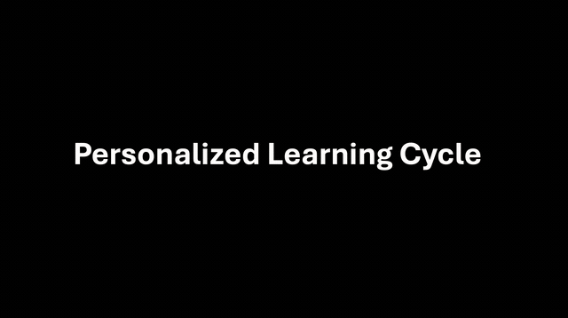
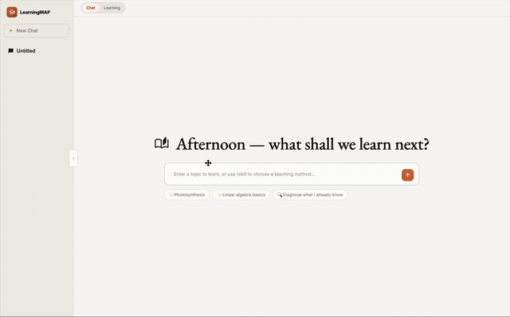

<p align="center">
  
</p>

# LearningMAP: Learning via Memory and Personalization

<p align="center">
  <a href="./README.md"></a>
  <a href="./README_CN.md"></a>
</p>

<p align="center"><b>One topic in → a full adaptive course out.</b><br>
Knowledge graph → quiz → diagnosis → lesson → slide deck → review, generated on the fly and remembered across sessions.</p>

<p align="center">
  
  
  
  
</p>

<p align="center">
  <a href="resources/cs_demo.mov"></a>
</p>

---

## Table of Contents

- [Overview](#overview)
- [Demos](#demos)
- [Quickstart](#quickstart)
- [Key Features](#key-features)
- [Capabilities Summary](#capabilities-summary)
- [Installation](#installation)
- [Configuration](#configuration)
- [Status](#status)

> **Technical reference** — architecture, API, frontend pages, repository layout, hardware sizing, and development conventions live in [ARCHITECTURE.md](ARCHITECTURE.md).

---

## Overview

- **One topic in, a full study plan out.** A student enters a topic; LearningMAP builds an adaptive learning loop around it, end to end.
- **Complete, working demo.** Full cycle — chat, quiz, learn, review — with everything streamed live to the browser.
- 🚀 **Personalized to each learner.** Adapts to actual mastery and remembers across sessions via a human-like memory system.
- 🚀 **Focused on what's tested.** Expert-backed, knowledge-level skills keep every lesson on the exam-critical points. **We're open-sourcing `XXX` distilled K-12 math skills today — with more skills and more subjects on the way.**

LearningMAP takes a topic the learner types in and runs it through one adaptive loop — knowledge graph, quiz, diagnosis, targeted lesson, and slide deck — then remembers what happened for the next session.

---

## Demos

Two end-to-end walkthroughs of the learning loop on different subjects:

> Recordings are sped up (~6×). Click a clip to open the full `.mov` for real-time playback.

### Computer Science

[](resources/cs_demo.mov)

### Physics

[](resources/phy_demo.mov)

---

## Quickstart

Get the main service running in three steps (cross-session memory is optional — see [Installation](#installation)):

```bash
# 1. Install the main service
uv sync

# 2. Configure — point at any OpenAI-compatible LLM gateway
cat > .env <<'EOF'
OPENAI_API_KEY=sk-xxxxxxxx
OPENAI_BASE_URL=https://api.deepseek.com/v1
LLM_MODEL=deepseek-chat
EOF

# 3. Run, then open http://localhost:8080
uv run python run/serve.py
```

---

## Key Features

### 📚 Learning Content Pipeline

A linear loop converts a topic into multi-format study materials:

- **Knowledge Graph** — entity/skill graph with mastery annotations (`mastery_annotator.py`).
- **Adaptive Quiz** — questions calibrated to the current KG mastery state.
- **Grading & Diagnosis** — per-question grading feeds a diagnosis card and a learning radar chart.
- **Markdown Lesson** — targeted to the weak points exposed by diagnosis; streamed via SSE.
- **Slide Deck** — outline-first pipeline, exported to `.pptx` via `python-pptx`. The post-processing chain enforces a 1000 × 562.5 canvas, repairs LaTeX/CJK elements, and assigns stable IDs (see [ARCHITECTURE.md](ARCHITECTURE.md#slide-post-processing-chain)).

### 🧠 Persistent Memory

An independent FastAPI microservice (`student_memory/`) provides:

- `POST /retrieve` — semantic recall injected into the chat node's system prompt.
- `POST /ingest` — sub-topic-level MemoryUnits written at end of diagnosis / lesson.
- `POST /notes` and `GET /notes/{uid}/neighbors` — 4-category L2 reflection notes for wrong-answer review.

The seam is a single file, `src/memory_client.py`. **When the service is unavailable, the main service degrades gracefully** — no context injection, no ingest writes, no blocking.

### 🎓 Pluggable Pedagogy Skills

Teaching style is a swappable artifact, not code:

- Each pedagogy is a directory containing one `SKILL.md` (e.g. `skills/feynman/`, `skills/scaffolding/`, `skills/socratic/`).
- Adding a new pedagogy is **one new directory + one `SKILL.md` — zero Python changes**.
- A separate **KC-skill bank** (built offline via `run/build_kc_skills.py`) is resolved per topic by `kc_skill_resolver.py`, allowing skill injections to be scoped to specific knowledge components.
- Skills are toggled at runtime via `POST /api/chat/{sid}/set-skill`.

### 🔁 Review Loop (L2 Reflection)

After the main learning loop, the review node:

- Generates 4-category wrong-answer summaries.
- Persists them to `student_memory` via `/notes`.
- Subsequent sessions surface these notes through `/retrieve`, closing the cross-session feedback loop.

The minimum gap between review runs is bounded by `REVIEW_MIN_AGE_SECONDS` (default 24 h).

---

## Capabilities Summary

Three selling points — and what each is built on.

### 1 · Personalized learning experience

Adapts to each student's actual mastery, powered by a human-like memory system that remembers across sessions — prior sessions resurface as system-prompt augmentations, and teaching style is switchable at runtime.

> **Built on:** knowledge graph + cross-session memory (`student_memory/`, decoupled behind a single seam and degraded gracefully when offline) + pluggable pedagogy (`skills/<name>/SKILL.md`).

### 2 · Expert-backed, knowledge-level skills

Distilled from real exam questions and expert teaching, scoped to specific knowledge components — so materials hit what's tested, never generic.

> **Built on:** the KC-skill bank (built offline via `run/build_kc_skills.py`, resolved per topic by `kc_skill_resolver.py`).

### 3 · Full-cycle, production-ready

A working end-to-end demo covering the complete journey: chat → quiz → grading → diagnosis → lesson → review, all derivable from session state on refresh and streamed live to the browser.

> **Built on:** FastAPI + SSE streaming everywhere (chat / lesson / slides), with Markdown lessons re-rendered as 16:9 slide decks (1000 × 562.5 canvas, LaTeX/CJK-aware) and `.pptx` export.

---

## Installation

### Prerequisites

| Dependency | Version | Notes |
|---|---|---|
| Python | 3.11 | Locked by `.python-version` |
| [uv](https://docs.astral.sh/uv/) | 0.4+ | Only supported package manager |
| SQLite | 3.35+ | Bundled with Python |
| OpenAI-compatible LLM | — | DeepSeek / Moonshot / any OpenAI-compatible gateway |

### Local

```bash
uv sync                                # main service
cd student_memory && uv sync && cd ..  # memory subservice (optional)
```

### Running

**Main service (port 8080)**

```bash
uv run python run/serve.py
# Uvicorn → http://0.0.0.0:8080
```

**Memory subservice (port 8090, optional)**

```bash
cd student_memory
SM_USE_FAKE_EMBEDDER=1 uv run uvicorn app.main:app --host 127.0.0.1 --port 8090
```

> When the memory service is unavailable, the main service **gracefully degrades** (no `context_text` injection, no `ingest` writes) without blocking the conversation.

Open `http://localhost:8080/` once the main service is running — FastAPI serves `static/` from the root.

---

## Configuration

All variables read by the main service (set in `.env` or process environment):

| Variable | Default | Purpose |
|---|---|---|
| `OPENAI_API_KEY` | — | **Required**. LLM authentication. |
| `OPENAI_BASE_URL` | — | **Required**. OpenAI-compatible endpoint. |
| `LLM_MODEL` | — | **Required**. Model name. |
| `MEMORY_SERVICE_URL` | `http://127.0.0.1:8090` | `student_memory` service address. |
| `ALLOWED_ORIGINS` | `*` | Comma-separated CORS whitelist. |
| `REVIEW_MIN_AGE_SECONDS` | `86400` | Minimum interval between review-node invocations (seconds). |
| `CLASSBA_AUTH` / `CLASSBA_API_URL` / `CLASSBA_AGENT_NAME` | — | Optional. For ClassBA external Agent calls. |

The LLM client is hardcoded to **bypass the OS HTTP proxy** (see commit `fc7e51c`); no additional proxy configuration is needed.

Example `.env`:

```bash
OPENAI_API_KEY=sk-xxxxxxxx
OPENAI_BASE_URL=https://api.deepseek.com/v1
LLM_MODEL=deepseek-chat

# Optional — defaults are used if omitted
MEMORY_SERVICE_URL=http://127.0.0.1:8090
ALLOWED_ORIGINS=*
REVIEW_MIN_AGE_SECONDS=86400
```

---

## Status

Internal research project. Unreleased.

---

For repository layout, hardware sizing, and development conventions, see **[ARCHITECTURE.md](ARCHITECTURE.md)**.
